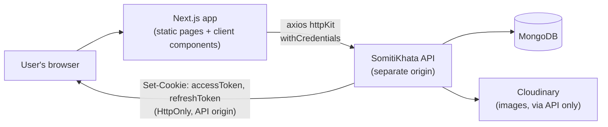
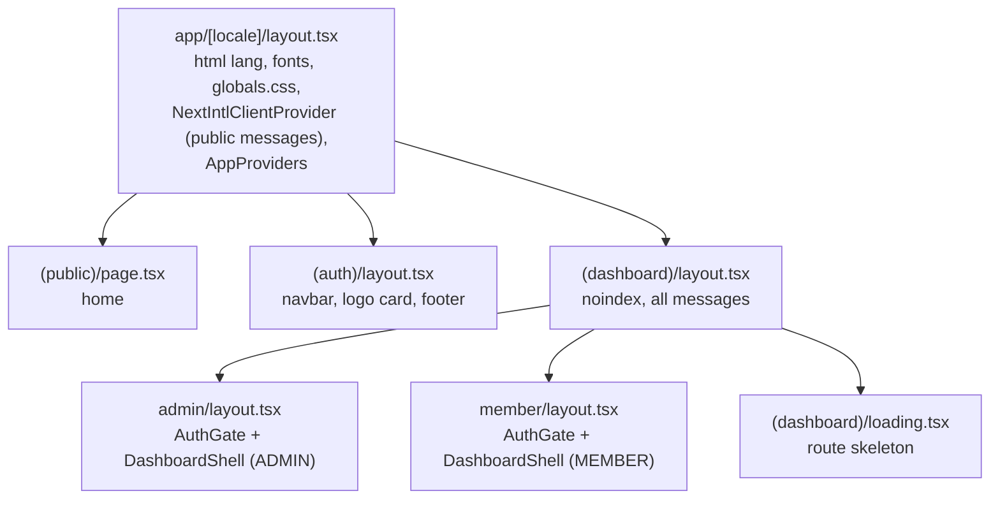
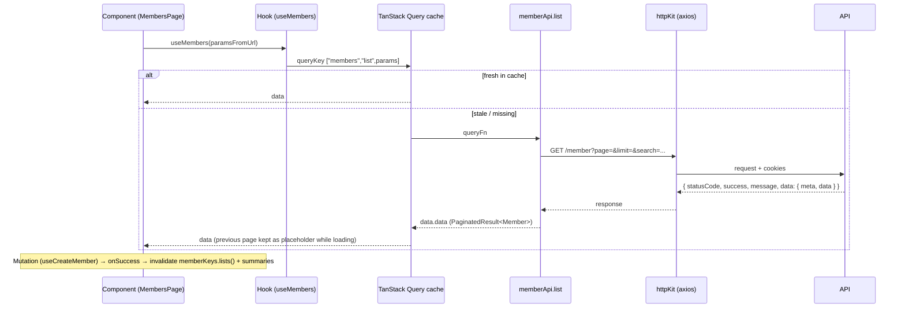

# Architecture

How the SomitiKhata web app is organised: folders, rendering, routing, layouts, providers and the
path of data from the API to the screen.

## Contents

- [Overview](#overview)
- [Folder responsibilities](#folder-responsibilities)
- [Feature module anatomy](#feature-module-anatomy)
- [Routing](#routing)
- [Layouts and guards](#layouts-and-guards)
- [Rendering strategy](#rendering-strategy)
- [Providers](#providers)
- [Data flow](#data-flow)
- [Internationalization](#internationalization)
- [Metadata and SEO](#metadata-and-seo)
- [PWA](#pwa)
- [Dependency rules](#dependency-rules)

## Overview



- The Next.js server serves pages; it **does not call the API** and never sees the auth cookies.
- All data is fetched **in the browser** by TanStack Query hooks through one axios instance.
- Images (member photo, NID, signature, avatars) are fetched from the API as bytes and shown as
  data URLs; the browser never talks to Cloudinary.

## Folder responsibilities

| Folder | Holds | Rules |
|---|---|---|
| `src/app/` | Routes: `layout.tsx`, `page.tsx`, `error.tsx`, `not-found.tsx`, `loading.tsx`, SEO routes (`robots.ts`, `sitemap.ts`, `manifest.ts`) | Routing only. A page imports a feature component and exports its metadata. |
| `src/features/<name>/` | One feature: `api.ts`, `query-keys.ts`, `types.ts`, `schemas.ts`, `hooks/`, `components/`, error mappers | Everything a feature needs, close together |
| `src/components/ui/` | Primitives (`Button`, `Input`, `Dialog`, `SelectMenu`, …) | No feature knowledge, no API calls |
| `src/components/shared/` | App-wide pieces (`PageHeader`, `Money`, `Pagination`, list states, toasts, …) | Reused by several features |
| `src/components/layout/` | Public navbar and footer | Public pages only |
| `src/lib/` | Framework-free helpers and infrastructure: `http/`, `query/`, money, dates, env, metadata | No JSX (except `query-provider.tsx`) |
| `src/providers/` | `AppProviders` | Client providers mounted once |
| `src/i18n/` | next-intl routing, navigation helpers, request config, message loading | |
| `src/types/` | Shapes shared with the API (`ApiEnvelope`, `PaginatedResult`, `Address`) | |
| `messages/<locale>/` | Translations, one JSON file per area | Same keys in `en` and `bn` |
| `public/branding/` | Logos, icons, share image | File names are referenced by metadata and the manifest |

Features: `admins`, `auth`, `collections`, `dashboard`, `documents`, `home`, `ledger-heads`,
`loans`, `member-area`, `members`, `membership`, `nominees`, `overview`, `profile`, `reports`,
`settings`, `users`, `year-end`.

## Feature module anatomy

Example: `src/features/members/`.

| File | Role |
|---|---|
| `types.ts` | API shapes (`Member`, `CreateMemberPayload`, `MemberListParams`) |
| `api.ts` | `memberApi`: plain async functions calling `httpKit`; returns `data.data` |
| `query-keys.ts` | `memberKeys.all`, `.lists()`, `.list(params)` |
| `schemas.ts` | Zod form schemas built with translations (`createMemberSchema({ t, … })`) |
| `hooks/` | `useMembers` (query), `useCreateMember`, `useUpdateMember`, … (mutations), URL-state hooks |
| `member-form-errors.ts` | Maps an `ApiError` to field errors / form error |
| `invalidate-member-views.ts` | Which caches to refresh after a member changes |
| `components/` | `MembersPage`, table, toolbar, dialogs |

A page file stays tiny:

```tsx
// src/app/[locale]/(dashboard)/admin/members/page.tsx
import { Suspense } from "react";

import { MembersLoading } from "@/features/members/components/members-list-states";
import { MembersPage } from "@/features/members/components/members-page";
import { pageTitleMetadata } from "@/lib/metadata";

export const generateMetadata = pageTitleMetadata("members");

// Suspense is needed because the page reads the URL search params.
export default function AdminMembersPage() {
  return (
    <Suspense fallback={<MembersLoading />}>
      <MembersPage />
    </Suspense>
  );
}
```

## Routing

All pages live under `src/app/[locale]/`; the locale is **always** the first URL segment
(`localePrefix: 'always'`), default `bn`.

| URL | File | Access |
|---|---|---|
| `/{locale}` | `(public)/page.tsx` | everyone |
| `/{locale}/login` | `(auth)/login/page.tsx` | everyone (the form is shown even when signed in; see note under [Layouts and guards](#layouts-and-guards)) |
| `/{locale}/register` | `(auth)/register/page.tsx` | everyone (explains how membership is opened) |
| `/{locale}/admin/dashboard` | `(dashboard)/admin/dashboard` | admin, super admin |
| `/{locale}/admin/members`, `/admin/members/pending` | `(dashboard)/admin/members/…` | admin, super admin (`pending` = coming soon) |
| `/{locale}/admin/collections` (+ `/passbook`, `/cash-book`, `/society`, `/heads`, `/opening`) | `(dashboard)/admin/collections/…` | admin, super admin |
| `/{locale}/admin/loans`, `/admin/year-end`, `/admin/reports` | `(dashboard)/admin/…` | admin, super admin |
| `/{locale}/admin/admins`, `/admin/settings`, `/admin/profile` | `(dashboard)/admin/…` | admin, super admin (some actions super admin only) |
| `/{locale}/member/dashboard`, `/member/savings`, `/member/loans`, `/member/membership`, `/member/profile` | `(dashboard)/member/…` | member |
| `/{locale}/member/savings/deposit-request`, `/member/loans/apply`, `/member/settings` | `(dashboard)/member/…` | member (coming soon) |
| `/{locale}/unauthorized` | `unauthorized/page.tsx` | everyone, `noindex` |
| `/{locale}/<anything else>` | `[...rest]/page.tsx` → `notFound()` | localized 404 with status 404 |

Route groups `(public)`, `(auth)`, `(dashboard)` share layouts without adding URL segments. Page
state such as list filters lives in **URL search params** (`?page=&search=&status=`), so refresh,
back and shared links keep the view.

`src/proxy.ts` is the Next.js 16 middleware ("proxy"): it runs next-intl's locale routing for
every path except `/api`, `/_next` and files with an extension. It does **no** authentication.

Navigation uses the locale-aware helpers from `src/i18n/navigation.ts` (`Link`, `useRouter`,
`usePathname`, `redirect`, `getPathname`) so the locale stays in the URL. From `next/navigation`
the code uses only `useSearchParams` (list URL state) and `notFound()`. A few error pages import
`next/link` directly (`not-found.tsx`, `unauthorized/page.tsx`).

## Layouts and guards



| Layout | Does |
|---|---|
| `[locale]/layout.tsx` | Validates the locale (404 otherwise), `setRequestLocale`, `<html lang>`, fonts, site metadata, sends only `PUBLIC_CLIENT_MESSAGES` to the browser, mounts `AppProviders` |
| `(auth)/layout.tsx` | Public navbar, a centred card with the logo, footer (server component) |
| `(dashboard)/layout.tsx` | `robots: noindex, nofollow`; sends **all** messages to the browser |
| `admin/layout.tsx`, `member/layout.tsx` | `AuthGate` (session, role area, forced password change) + `DashboardShell` (sidebar, header, mobile navigation) with the sidebar items for that area |

`AuthGate` is a client component that reads `useMe()`. `GuestGate`
(`features/auth/components/guest-gate.tsx`, redirects a signed-in user to their area) exists but
**is not mounted anywhere** today, so `/login` shows the form to a signed-in user too (the navbar
shows their account menu). See [AUTHENTICATION.md](AUTHENTICATION.md).

## Rendering strategy

| Area | Rendering | Why |
|---|---|---|
| Home, login, register | Static (generated per locale via `generateStaticParams`), Server Components; client islands only for the navbar account menu, home actions, login form and footer account links | Same for every visitor |
| `/admin/*`, `/member/*` | Static shell (layouts, sidebar, page frame) + Client Components using TanStack Query | Session cookies belong to the API's origin, so only the browser can fetch user data |
| Unknown URLs | `[...rest]` → `notFound()` | Real HTTP 404 with the localized page |

- No SSR data fetching and no ISR: there is no public data that changes. If a public, changing page
  is added (for example notices from the API), fetch it in a Server Component with
  `next: { revalidate: <seconds> }`.
- `loading.tsx` exists only in `(dashboard)`, so public pages and the 404 are not streamed behind a
  fallback (a 404 must return status 404).
- Server Components that call `useTranslations()` rely on `setRequestLocale()` in the layout/page
  and `requestLocale` in `i18n/request.ts`.

## Providers

`src/providers/app-providers.tsx` (client), mounted once in the root layout:

```text
QueryProvider (TanStack QueryClient: one per browser session, new per server render)
└── ToastProvider (useToast)
    ├── SessionExpiredListener   refresh failed → clear cache → /login (protected areas only)
    ├── MutationLoadingToasts    a loading toast for every running mutation
    └── children
```

Query client defaults (`lib/query/make-query-client.ts`): `staleTime` 60 s, `gcTime` 30 min,
`refetchOnWindowFocus: false`, `refetchOnReconnect: true`, queries retry twice only for status 0,
408, 429 and 5xx; mutations never retry.

## Data flow



Rules of the data layer are in [API.md](API.md).

## Internationalization

- `src/i18n/routing.ts`: locales `en`, `bn`; default `bn`; prefix always.
- `src/i18n/messages.ts`: `MESSAGE_FILES` lists the files in `messages/<locale>/` (`common`,
  `home`, `auth`, `dashboard`, `profile`, `members`, `collections`, `admins`, `nominees`, `users`,
  `settings`, `heads`, `loans`, `yearend`, `reports`, `overview`, `documents`); each file holds
  top-level namespaces (e.g. `auth.json` → `Auth`).
- `src/i18n/request.ts`: picks the locale (explicit → request → default) and loads the messages.
- `src/i18n/client-messages.ts`: `PUBLIC_CLIENT_MESSAGES`, the namespaces sent to the browser on
  public pages. A new client component on a public page that reads another namespace must be
  listed there.
- `html[lang]` switches the body font (Inter for `en`, Hind Siliguri for `bn`).

Details and rules: [DESIGN.md](DESIGN.md#internationalization).

## Metadata and SEO

`src/lib/metadata.ts`:

- The root layout uses `siteMetadata(locale)`: title template `Page | Site`, description, icons,
  Open Graph/Twitter cards (`public/branding/og-image.png`, 1200×630), `metadataBase` from
  `getSiteUrl()`.
- Signed-in and utility pages export `pageTitleMetadata("<key>")`.
- Public pages export `publicPageMetadata("<key>", "/path")`: canonical, `hreflang` (`en`, `bn`,
  `x-default`) and their own share card.
- Titles live in `messages/<locale>/common.json` → `Metadata.pages`; a new page needs a key in
  both locales (and in the `PageTitleKey` type).
- `robots.ts` disallows `/<locale>/admin`, `/<locale>/member`, `/<locale>/unauthorized`;
  `sitemap.ts` lists `/`, `/login`, `/register` per locale.

## PWA

`src/app/manifest.ts` serves the web app manifest (icons from `public/branding`). `src/app/sw.ts`
is a minimal pass-through service worker, and Serwist is configured in `next.config.mjs` with
**`disable: true`**, so no service worker is built or registered today. Turning it on is a separate
decision (caching a financial app's pages needs care).

## Dependency rules

- `app/` → `features/`, `components/`, `lib/`. Never the other way round.
- `features/<a>` may import another feature's **public pieces** (types, query keys, hooks,
  invalidation helpers) when the data really belongs there, e.g. members → `collectionKeys`,
  `loanKeys`, `invalidateSummaries`.
- `components/ui` imports nothing from `features/`.
- `lib/` imports no React components (hooks such as `useSubmitLock` are fine).
- No new package without a named, concrete need and the owner's approval.
