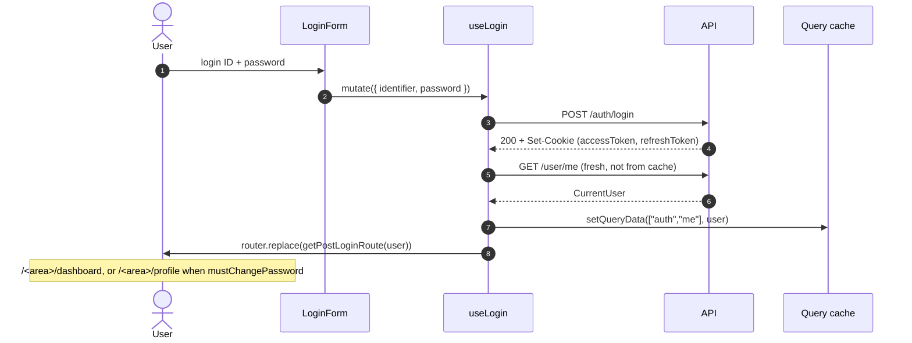
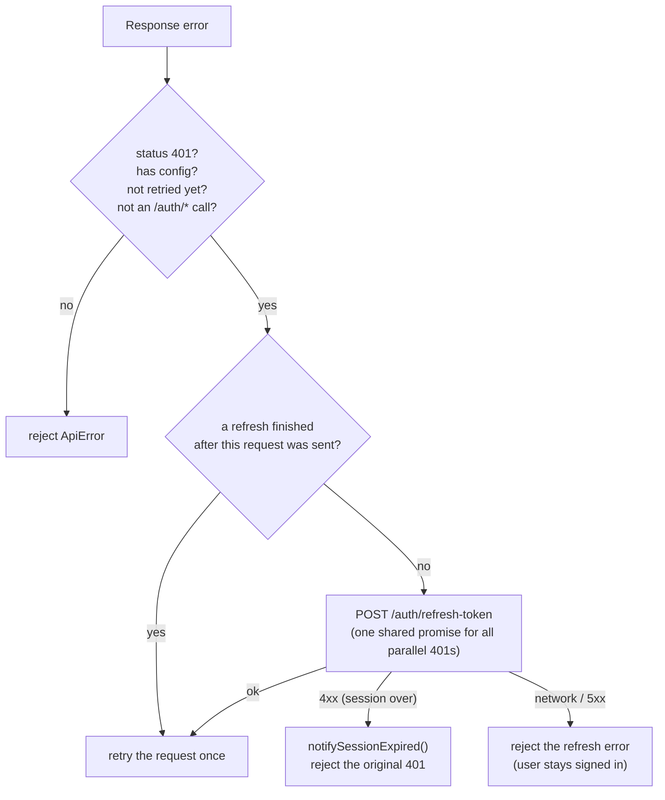

# Authentication (frontend)

How the web app signs users in, keeps the session, protects pages and signs out. The server side
(tokens, cookies, `checkAuth`, roles, lockout) is documented in the backend's
[`docs/AUTHENTICATION.md`](https://github.com/Humayun1318/bottolisomobai-server/blob/main/docs/AUTHENTICATION.md)
(private repository), which also has end-to-end sequence diagrams.

## Contents

- [The model in one paragraph](#the-model-in-one-paragraph)
- [Pieces](#pieces)
- [Signing in](#signing-in)
- [Who is signed in: useMe](#who-is-signed-in-useme)
- [Protecting pages: AuthGate](#protecting-pages-authgate)
- [Refreshing the session](#refreshing-the-session)
- [Session expiry](#session-expiry)
- [Signing out](#signing-out)
- [First password and password change](#first-password-and-password-change)
- [Roles and areas](#roles-and-areas)
- [Login error messages](#login-error-messages)
- [Security rules](#security-rules)

## The model in one paragraph

The API sets two **HttpOnly cookies** (`accessToken`, `refreshToken`) on **its own origin**. The
browser stores them and sends them with every `httpKit` request (`withCredentials: true`). The app
never sees a token. Because the Next.js server never receives those cookies, the app decides who
is signed in **in the browser**, by asking `GET /user/me`. Page guards only decide what to show;
the API enforces every permission.

## Pieces

| File | Role |
|---|---|
| `src/lib/http/http-kit.ts` | The axios instance (`withCredentials: true`) |
| `src/lib/http/auth-refresh.ts` | 401 → one shared refresh → retry once; session-over detection |
| `src/lib/http/session-events.ts` | `registerSessionExpiredHandler`, `notifySessionExpired` (bridge from axios to React) |
| `src/features/auth/api.ts` | `authApi.login`, `logout`, `refresh`, `me`, `changePassword` |
| `src/features/auth/hooks/use-login.ts` | Log in, load the user, cache it, redirect |
| `src/features/auth/hooks/use-me.ts` | The signed-in user (`["auth","me"]`) |
| `src/features/auth/hooks/use-logout.ts` | Log out and forget everything |
| `src/features/auth/hooks/use-change-password.ts` | Change password mutation |
| `src/features/auth/end-session.ts` | Cancel queries, drop cached data, set user to `null` |
| `src/features/auth/components/auth-gate.tsx` | Guard for `/admin` and `/member` layouts |
| `src/features/auth/components/guest-gate.tsx` | Guard for guest-only pages (exists, **not mounted** anywhere today) |
| `src/features/auth/components/session-expired-listener.tsx` | Redirects to sign-in when the refresh fails in a protected area |
| `src/features/auth/role-routes.ts` | Role → area, area routes, post-login route |
| `src/features/auth/login-errors.ts` | Maps login failures to translated messages |
| `src/features/auth/components/login-form.tsx`, `schemas.ts` | The form and its Zod schema |
| `src/proxy.ts` | Locale routing only; **no** auth |

## Signing in



- `identifier` accepts a member number (`LBKS-0001` or `1`), a staff ID (`ADM-0001`, `SADM-…`)
  or an email; the backend resolves it.
- The client schema only checks that both fields are filled (password at least 6 characters
  here); the backend is the real check.
- The login mutation has `meta.loadingMessage: "login"`, so a loading toast appears
  automatically.

## Who is signed in: useMe

```ts
const { data: user } = useMe();   // CurrentUser | null | undefined
```

- `undefined` while loading, a `CurrentUser` when signed in, `null` after an intentional sign-out
  or session end (`endSession`).
- Cached under `["auth","me"]` for 5 minutes. Under a protected layout `AuthGate` has already
  loaded it, so components read it without a new request.
- On a page reload it **restores the session**: if the access cookie expired, `httpKit` refreshes
  and retries before `useMe` resolves.
- `CurrentUser` includes `role`, `mustChangePassword`, `memberNo` or `staffNo`, and
  `avatar: { version } | null`.

## Protecting pages: AuthGate

`admin/layout.tsx` and `member/layout.tsx` wrap their pages in `<AuthGate>`:

| Situation | Result |
|---|---|
| `useMe` still loading | `AuthLoading` screen |
| No user (`null`) or a 401 error | Redirect to `/login` |
| Another error (network, 5xx) and no user yet | Thrown to the error boundary (`error.tsx`), **not** treated as logged out |
| Signed in, but the URL's area does not match the role's area | Error toast + `AccessDenied` page (no redirect) |
| Signed in, `mustChangePassword`, not on own profile page | Redirect to `/<area>/profile` |
| Otherwise | The page |

The area comes from the URL (`/admin/...` → `admin`), so pages need no props. A failed
**background** refetch of `/user/me` keeps the user and the page.

`GuestGate` (sends a signed-in user from a guest page to their area) is implemented but not used
by any page at the moment; `/login` shows the form to everyone, and the navbar shows a signed-in
user's account menu.

## Refreshing the session

`attachAuthRefresh(httpKit)` (`src/lib/http/auth-refresh.ts`):



- Only one refresh runs at a time; parallel 401s wait for the same promise.
- A request sent with the old token after which a refresh already finished is just re-sent.
- Each request is retried **once** (`_retry`), so there are no loops.

## Session expiry

`SessionExpiredListener` (mounted in `AppProviders`) registers the handler that
`notifySessionExpired()` calls:

- On a protected page (`/admin/*`, `/member/*`): `endSession(queryClient)` and redirect to
  `/login`.
- On a public page: nothing (a guest's failed `/user/me` check is not an expired session).

## Signing out

`useLogout()` calls `POST /auth/logout` (the API clears the cookies) and **always**, even if that
request fails, runs `endSession(queryClient)` and redirects to `/login`:

1. cancel running queries (none lands later or fails with 401);
2. remove every cached query except the user;
3. set the user to `null` (so `AuthGate` unmounts protected pages at once and the login page
   does not ask `/user/me` again).

This guarantees the next person on a shared office computer never sees cached data.

## First password and password change

- New member accounts and accounts reset by an admin start with the phone number as password
  and `mustChangePassword: true`. The API then allows only `GET /user/me`,
  `GET /user/me/avatar` and the password change; `AuthGate` keeps the user on their profile page.
- The change-password form checks the rules instantly with `PASSWORD_RULES`
  (`src/lib/password-rules.ts`, mirroring the backend: 8+ characters, upper, lower, number, one of
  `@$!%*?&`) and shows `PasswordRulesChecklist`.
- After a successful change the backend invalidates **all** existing tokens, so the caller must
  sign out (`useLogout`) and the user signs in with the new password
  (`profile/components/change-password-dialog.tsx` calls `useLogout` after success).

## Roles and areas

| API role | Area | Routes |
|---|---|---|
| `super_admin` | `admin` | `/admin/*`; extra actions (create admins, settings, cash accounts, ledger heads, openings, year-end runs) are shown only when `user.role === "super_admin"` |
| `admin` | `admin` | `/admin/*` |
| `member` | `member` | `/member/*` |
| unknown role | `member` | least privileged fallback |

`role-routes.ts`: `getRoleArea(role)`, `getAreaFromPathname(pathname)`,
`getDashboardRoute(area)`, `getProfileRoute(area)`, `getSettingsRoute(area)`,
`getPostLoginRoute(user)`, `LOGIN_ROUTE`.

Sidebar items are configured per area in `features/dashboard/config/sidebar.ts` (roles `ADMIN`,
`MEMBER`) and filtered by `filterSidebarItemsByRole`. Hiding a link is a convenience, not
security.

## Login error messages

The backend sends messages, not codes. `getLoginError(error, t)` maps them:

| Backend answer | Shown |
|---|---|
| status 0 (no response, CORS, offline) | network message |
| 401 `Invalid login ID or password` | invalid credentials |
| 403 `Too many wrong attempts. Try again in N minute(s).` | locked, with N from the message |
| 403 `Your account is inactive` / `suspended` … | account status message |
| other 4xx | the backend's message |
| 5xx / unknown | generic message |

If the backend changes these texts, update the patterns in `login-errors.ts` in the same change.

## Security rules

- Never store a token or user data in `localStorage`, `sessionStorage` or a readable cookie.
- Never trust the client guards for security; the API checks every request.
- Every request goes through `httpKit`; no other client sends credentials.
- Keep `endSession` in every sign-out path.
- Do not add auth logic to `src/proxy.ts`: the Next.js server cannot see the API's cookies.
