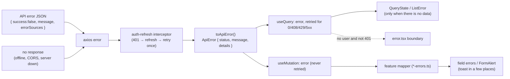

# Error Handling (frontend)

How failures travel from the API to the screen, and what the user sees. The backend's error
format and status codes are documented in the backend's
[`docs/ERROR_HANDLING.md`](https://github.com/Humayun1318/bottolisomobai-server/blob/main/docs/ERROR_HANDLING.md)
(private repository).

## Contents

- [The flow](#the-flow)
- [ApiError](#apierror)
- [Retries](#retries)
- [Reads: what the user sees](#reads-what-the-user-sees)
- [Writes: forms and actions](#writes-forms-and-actions)
- [Feature error mappers](#feature-error-mappers)
- [Error pages](#error-pages)
- [Auth errors](#auth-errors)
- [Rules](#rules)

## The flow



## ApiError

`src/lib/api-errors.ts`:

```ts
class ApiError extends Error {
  readonly status: number;   // HTTP status; 0 = no response
  readonly code?: string;    // the backend sends none today
  readonly details?: unknown; // the backend's error body (errorSources, …)
}
```

`toApiError(error: AxiosError)` (`src/lib/http/to-api-error.ts`) builds it from
`response.status`, `response.data.message` (fallback: axios' message) and `response.data`.
Every hook types its error as `ApiError` (`useQuery<Data, ApiError>`).

Field errors from the backend are in `(error.details as { errorSources?: { path, message }[] }).errorSources`.
The backend sends only the **last** segment of a nested path (`district`, not
`presentAddress.district`), so nested errors are shown as a form-level message.

## Retries

From `make-query-client.ts`:

| Failure | Query retry | Mutation retry |
|---|---|---|
| status 0 (network), 408, 429, 5xx | up to 2 times (1 s, 2 s backoff) | never |
| 4xx (400, 401, 403, 404, 409, …) | never | never |

401 is handled before that by the refresh interceptor
([AUTHENTICATION.md](AUTHENTICATION.md#refreshing-the-session)).

## Reads: what the user sees

- **No data yet + error** → `ListError` (title + Retry button) or `QueryState`, which picks
  between loading, error and content:

  ```tsx
  // features/member-area/components/my-loans-page.tsx (shortened)
  <QueryState query={loans} errorTitle={t("loans.error")} retryLabel={t("retry")}>
    {(data) =>
      data.length === 0 ? (
        <ListEmpty icon={HandCoins} title={t("loans.emptyTitle")} body={t("loans.emptyBody")} />
      ) : (
        <ul className="grid gap-3 md:grid-cols-2">{/* one card per loan */}</ul>
      )
    }
  </QueryState>
  ```

- **Data on screen + background refetch fails** → keep the data, no error card.
- No toasts for reads.

## Writes: forms and actions

For every mutation:

1. The loading toast is automatic (`MutationLoadingToasts`).
2. On error, the component calls the feature mapper and shows the result **in the form**:
   - `setError(field, { type: "server", message }, { shouldFocus })` for field errors;
   - `FormAlert` (form-level message) when no field matches.
   A few places without a form to show the message in also call `toast.error` (the login form,
   `AuthGate`'s permission toast, the collections and ledger-heads pages).
3. The dialog stays open, inputs keep their values, the button re-enables.
4. On success: `toast.success(<specific message>)` and close the dialog.

Example (`members/components/member-form-dialog.tsx`):

```tsx
try {
  const saved = await saveMember(values);
  onSaved?.(saved);
  onClose();
  toast.success(t(isEdit ? "editSuccess" : "success", { memberNo: saved.memberNo }));
} catch (error) {
  const result = getMemberFormErrors(error, t, isEdit ? "errors.editGeneric" : "errors.generic");
  result.fieldErrors.forEach(({ field, message }, index) => {
    setError(field, { type: "server", message }, { shouldFocus: index === 0 });
  });
  setFormError(result.formError);
  if (result.duplicateMemberNos) {
    setDuplicate({ nid: values.nid.trim(), memberNos: result.duplicateMemberNos });
  }
}
```

## Feature error mappers

Each feature turns an `ApiError` into what its UI needs. Backend messages are English; the
mappers recognise the ones users must understand and return translated text.

| Function | File | Handles |
|---|---|---|
| `getLoginError(error, t)` | `auth/login-errors.ts` | network, invalid credentials, lock minutes, inactive/suspended |
| `getChangePasswordErrors(error, t)` | `profile/change-password-errors.ts` | wrong old password, rule violations |
| `getMemberFormErrors(error, t, genericKey?)` | `members/member-form-errors.ts` | field errors, 409 duplicate NID (returns the existing member numbers) |
| `getNomineeFormErrors(error, t, genericKey)` | `nominees/nominee-form-errors.ts` | field errors, max/min nominee rules |
| `getAdminFormErrors(error, t)` | `admins/admin-form-errors.ts` | duplicate email, field errors |
| `getUserActionError(error, t, genericKey)` | `users/user-action-errors.ts` | status change / password reset refusals |
| `getCollectionError(…)` | `collections/collection-errors.ts` | ledger refusals: closed books, balance limits, reversal rules |
| `getLoanError(…)` | `loans/loan-errors.ts` | eligibility, one open loan, schedule |
| `getYearEndError(error, { t, tKind, tCollections, locale, fields })` | `year-end/year-end-errors.ts` | year-end run refusals |
| `checkImageFile(file, t)`, `getDocumentError(error, t, fallback)` | `documents/document-errors.ts` | client-side type/size check; 413/415/502/503 |

Common shape: status 0 → network message; known 4xx patterns → translated text; other 4xx →
the backend's message; 5xx/unknown → translated generic message.

When the backend changes a message that a mapper matches, update the mapper in the same change.

## Error pages

| File | When | Shows |
|---|---|---|
| `src/app/[locale]/error.tsx` | A render error or a thrown error inside a locale route (e.g. `AuthGate` with no user and a non-401 failure) | Localized error card with **Try again** (`reset`) |
| `src/app/global-error.tsx` | The root layout itself fails | Plain error page (own `<html>`, English) |
| `src/app/[locale]/not-found.tsx` | `notFound()` (unknown locale path via `[...rest]`, invalid locale) | Localized 404, HTTP 404 |
| `src/app/not-found.tsx` | 404 outside a locale | Fallback 404 |
| `src/app/[locale]/unauthorized/page.tsx` | Linked when access is refused | Access message, `noindex` |
| `AccessDenied` (component) | Signed in but wrong area | 403 card with a link to the user's own dashboard |

Both error boundaries log with `console.error` in the browser; there is no error reporting
service.

## Auth errors

- 401 on a normal request → refresh → retry (invisible to the user).
- Refresh refused (4xx) → `SessionExpiredListener` → cache cleared → `/login` (protected areas
  only).
- Refresh failed with network/5xx → the original request fails with that error; the user stays
  signed in and can retry.
- 403 → shown as an error (permission or account state); it never triggers a refresh.

## Rules

- Never `catch` an error just to ignore it; show something or rethrow.
- Never show raw technical text (stack traces, axios messages) for 5xx; use the generic message.
- Do not use `alert()` / `confirm()`; use toasts and dialogs.
- Keep the backend as the source of truth for validation; client checks are for instant feedback
  only.
- Show errors in the user's language; add keys to both `en` and `bn`.
